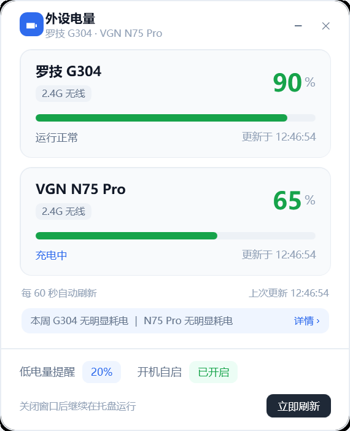
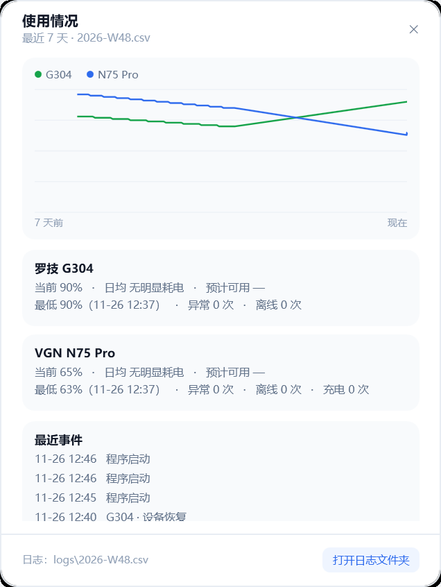

# 外设电量 · KeyMouse Battery

一个 Windows 托盘小工具：同时监控 **罗技 G304**（2.4G Lightspeed）与 **VGN N75 Pro**（2.4G）的电池电量，低电量时弹出提醒。

单文件 exe，约 65 KB，不依赖 .NET SDK，也无需安装任何运行时（使用 Windows 自带的 .NET Framework 4.8）。



## 特性

- **单托盘图标**：同时显示两只设备，悬停查看百分比；图标颜色随最低电量变化（绿 / 黄 / 红）
- **主面板**：电量、状态（正常 / 充电中 / 休眠 / 未连接）、更新时间一目了然
- **低电量提醒**：默认 20%，跨阈值只提醒一次，充电或回升后自动复位
- **使用记录**：每 5 分钟采样一次，按 ISO 周保存 CSV；自动记录充电开始/结束、休眠、离线、读数异常
- **使用情况**：主面板显示本周日均耗电，点击可查看 7 天趋势、预计可用天数、充电次数与最近事件
- **自动轮询**：每 60 秒刷新，也可手动刷新
- **开机自启**：写入 HKCU Run，无需管理员权限
- **关闭到托盘**：点「×」收进托盘；单实例，重复双击 exe 会唤回面板

## 支持设备

当前版本通过**接收器的 VID/PID + 私有协议**识别设备，开箱即用仅限实测机型：

| 设备 | 接收器 VID:PID | 协议 | 状态 |
|---|---|---|---|
| 罗技 G304 | `046D:C53F` | HID++ 2.0，特性 `0x1000` | ✅ 已验证 |
| VGN N75 Pro | `320F:5088` | Usage Page `0xFF1C`，Report `0x04` | ✅ 已验证 |

其他设备能否使用：

- **罗技其他 Lightspeed / Unifying 接收器**：把 `src/Devices/LogitechG304.cs` 里的 VID/PID 换成对应值即可尝试。程序会先找 `0x1001 UNIFIED_BATTERY`，不支持时退回 `0x1000`，但不同型号返回的字段位置可能不同，需要用 `tools/Probe.cs` 打印原始报文来校准。
- **VGN 其他键盘**：只要是同一颗 `320F:5088` 接收器、协议同为 `04 00 00 1A 06`，大概率可用，建议先用探针确认。
- **其他品牌**：各自使用私有协议（雷蛇、罗技以外基本不通用），需要单独实现驱动。

## 运行要求

- Windows 10 / 11（x64）
- .NET Framework 4.8（系统自带）
- 无需管理员权限

## 使用

- 左键点托盘图标 → 打开面板；右键 → 打开主界面 / 立即刷新 / 开机自启 / 退出
- 面板里的「×」是**收进托盘**，要彻底退出请右键托盘图标 → 退出
- 点击「20%」胶囊可在 10% / 15% / 20% / 30% 之间切换提醒阈值
- 主面板的「本周 …」概览行点击后打开使用情况窗口
- 配置：`%APPDATA%\KeyMouseBattery\settings.ini`
- 使用记录：`%APPDATA%\KeyMouseBattery\logs\2026-W48.csv`（按 ISO 周自动切换）
- 异常日志：`%APPDATA%\KeyMouseBattery\error.log`

## 使用记录与统计



CSV 每行一次采样或事件：

```
时间,设备,电量,充电,状态,事件,备注
2026-11-26 14:03:11,N75 Pro,44,1,充电中,充电开始,
2026-11-26 18:20:02,N75 Pro,100,0,正常,充电结束,
```

- **采样**：每 5 分钟一行；状态变化（充电、休眠、离线、异常、低电量提醒）即时追加
- **周切换**：文件名按 ISO 周（周一起算），例如 `2026-W48.csv`，跨周自动新建
- **日均耗电**：用相邻采样间的下降量估算，跳过充电区间与超过 20 分钟的断档，反映活跃使用时段的耗电速度
- **预计可用**：当前电量 ÷ 日均耗电，仅供参考（G304 为 AA 电池，受温度与使用强度影响）
- 电量粒度只有 1%，短期波动大，建议看 7 天整体趋势而不是单日数值

## 构建

```powershell
powershell -ExecutionPolicy Bypass -File build.ps1
```

产物为 `dist\KeyMouseBattery.exe`。使用系统自带的 `csc.exe`（.NET Framework 4.x）编译，不需要 .NET SDK 或 Visual Studio。

命令行探针（打印两台设备的原始报文，便于适配新机型）：

```powershell
powershell -ExecutionPolicy Bypass -File build.ps1 -Probe
& "$env:TEMP\kmb-probe.exe"
```

## 实现要点（踩坑记录）

1. **SetupAPI 路径**：`SP_DEVICE_INTERFACE_DETAIL_DATA.DevicePath` 需从偏移 4 处读取（x64 下 `cbSize` 仍要写 8），否则拿到的路径会缺前两个字符。
2. **双句柄**：HID 读写必须拆成两个句柄——读句柄用 `OVERLAPPED` + 事件超时 + `CancelIoEx`，写句柄保持同步。同一句柄阻塞读写会让进程直接崩溃。
3. **输出报文**：必须用 `WriteFile` 发送，`HidD_SetOutputReport` 会返回成功但实际无效。
4. **休眠处理**：G304 静止后会休眠，读不到响应时显示「已休眠」而不是旧值；VGN 键盘休眠时会吞掉第一次查询，需要重发（代码内最多重试 3 次）。
5. **VGN 固件异常值**：ADC 读取失败时固件可能固定返回 100%，若与上一次读数差距过大，界面会标记「读数存疑」。

## 目录结构

```
src/
  Hid/          SetupAPI/HID 枚举与双句柄收发
  Devices/      G304 HID++ 与 VGN 0xFF1C 驱动
  Services/     轮询、配置持久化、开机自启、使用记录（HistoryLog）、统计聚合（Statistics）
  UI/           托盘图标、主面板、设备卡片、电量条、使用情况窗口
tools/Probe.cs  命令行探针（打印原始读数）
build.ps1       一键构建脚本
```

## License

[MIT](LICENSE)
